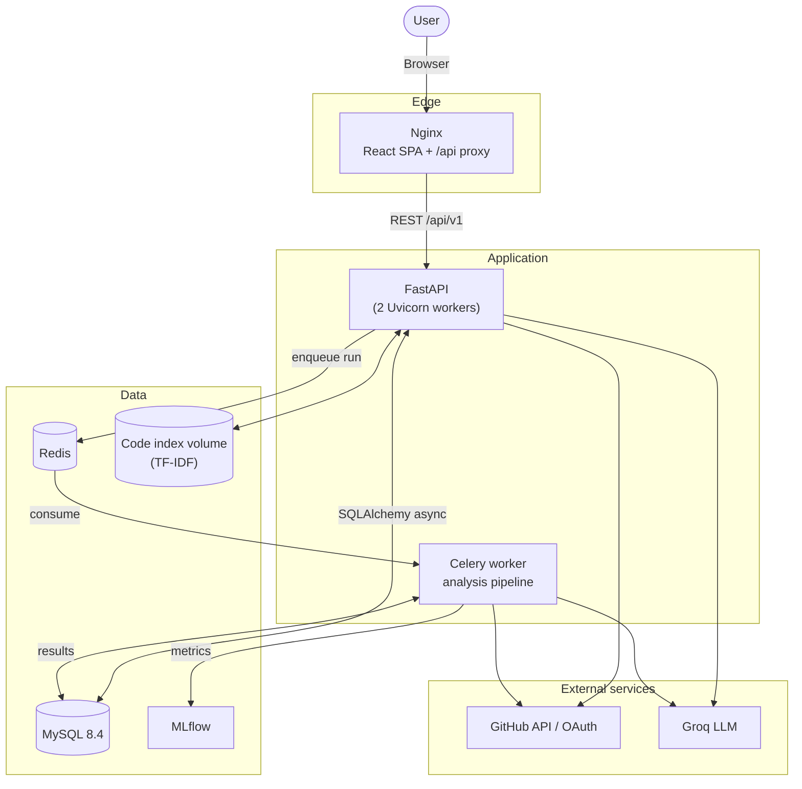
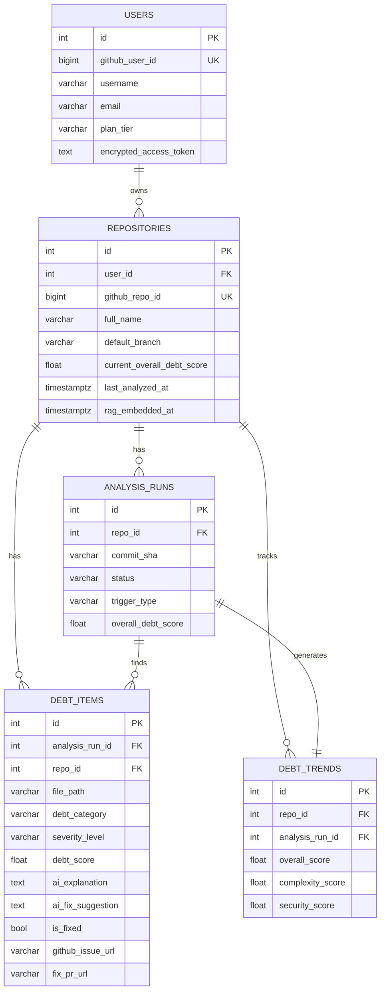

# RepoNexus System Architecture & Schema

## System Architecture

RepoNexus is an AI-powered repository intelligence and governance platform designed to analyze code and infrastructure. It identifies complexity, security issues, and maintainability concerns, while tracking repository health over time.

### Architecture Components

1. **Frontend (React 18 + Vite + TypeScript)** — served by Nginx in Docker (`:8080`). Nginx also reverse-proxies `/api` to the backend, so the browser only ever talks to one origin. Routes are lazy-loaded.

2. **Backend API (FastAPI)** — GitHub OAuth, JWT sessions, repository management, analysis orchestration and the AI helper endpoints. Cross-cutting concerns are handled in middleware: request IDs + structured JSON access logs, security headers, gzip and rate limiting (Redis-backed when available). Domain errors map to HTTP status codes through a global exception handler.

3. **Background worker (Celery)** — executes the analysis pipeline off the request path. When `TASK_EXECUTION_MODE=inline` (local development without Redis) the same job runs as a FastAPI background task instead. Runs left queued/running by a crash are marked failed on API startup, and only one active run per repository is allowed.

4. **Message broker (Redis)** — Celery broker/result backend and shared rate-limit counters.

5. **Database (MySQL 8.4 in Docker, SQLite for local development)** — async SQLAlchemy 2.0; schema owned by Alembic and migrated automatically by the container entrypoint.

6. **Analysis & AI**
   - **Pipeline** — tree-sitter AST, radon complexity, duplication fingerprints, dependency centrality (networkx), security/dependency/dead-code rules and documentation density.
   - **Code retriever** — a TF-IDF index over identifier-aware code tokens (scikit-learn). Built per analysis run for LLM context, and persisted per repository for Code Chat.
   - **Groq LLM** — explanations, fix suggestions and the document/review generators. Multiple API keys rotate automatically on rate limits; when no key is configured AI endpoints return `503` and the rest of the platform keeps working.
   - **Local models (`own_models/`)** — XGBoost debt-health scorer and rule-based zombie-code, security, migration-risk and cost scanners, used before falling back to the LLM.
   - **MLflow** — every analysis run logs its parameters and debt metrics.

### Architecture Diagram

### Analysis request flow

1. `POST /api/v1/analysis/{repo_id}/runs` validates ownership, rejects the request with `409` if a run is already active, stores a `queued` run and returns `202`.
2. The worker marks the run `running`, resolves the head commit and fetches source files through the Git Trees API.
3. The pipeline produces findings, scores them, estimates effort and enriches the highest-impact ones with LLM explanations using retrieved code context.
4. Findings, the trend snapshot and the MLflow run ID are committed in one transaction and the run becomes `completed` (or `failed` with the error message).

---

## SQL Schema (Entity-Relationship)

The system relies on a relational database managed by SQLAlchemy models. Below is the detailed breakdown of the schema and how the entities are connected.

### Entities

1. **`users`**
   - Represents the authenticated users (via GitHub).
   - **Key Fields**: `id`, `github_user_id`, `username`, `email`, `encrypted_access_token`, `plan_tier` (FREE, TEAM, ENTERPRISE).
   - **Relationships**: A user can own multiple `repositories` (1-to-Many).

2. **`repositories`**
   - Represents the GitHub repositories connected by the user.
   - **Key Fields**: `id`, `user_id`, `github_repo_id`, `full_name`, `default_branch`, `current_overall_debt_score`, `last_analyzed_at`, `rag_embedded_at`.
   - **Relationships**:
     - Belongs to a `user` (Many-to-1).
     - Has many `analysis_runs` (1-to-Many).
     - Has many `debt_items` (1-to-Many).
     - Has many `debt_trends` (1-to-Many).

3. **`analysis_runs`**
   - Records every analysis triggered (manual, webhook, or scheduled) for a repository.
   - **Key Fields**: `id`, `repo_id`, `commit_sha`, `status` (queued, running, completed, failed), `trigger_type`, `overall_debt_score`, `mlflow_run_id`.
   - **Relationships**:
     - Belongs to a `repository` (Many-to-1).
     - Generates many `debt_items` (1-to-Many).
     - Results in exactly one `debt_trend` (1-to-1).

4. **`debt_items`**
   - Stores individual code issues, complexity problems, or security smells found during an analysis run.
   - **Key Fields**: `id`, `analysis_run_id`, `repo_id`, `file_path`, `debt_category` (e.g., high_complexity, missing_tests), `severity_level` (low, medium, high, critical), `debt_score`, `ai_explanation`, `ai_fix_suggestion`, `is_fixed`, `github_issue_url`, `fix_pr_url`.
   - **Relationships**:
     - Belongs to an `analysis_run` and a `repository` (Many-to-1).

5. **`debt_trends`**
   - A historical snapshot of a repository's health metrics at the time of a specific analysis run.
   - **Key Fields**: `id`, `repo_id`, `analysis_run_id`, `overall_score`, `complexity_score`, `duplication_score`, `security_score`, `test_coverage_score`, `total_estimated_debt_hours`.
   - **Relationships**:
     - Belongs to a `repository` (Many-to-1).
     - Tied to a specific `analysis_run` (1-to-1).

### Schema Diagram

### Conventions

- Enum columns store their lowercase **values** (`queued`, `high_complexity`, …) and are native `ENUM` columns on MySQL.
- All timestamps are UTC. MySQL `DATETIME` has no offset, so the server runs with `default-time-zone=+00:00` and the `UTCDateTime` column type (`app/models/base.py`) stores naive UTC and returns timezone-aware values.
- The tables use `utf8mb4`; `debt_items.file_path` (up to 1024 chars) is indexed on a 255-character prefix to stay under MySQL's 3072-byte key limit.
- Deleting a user cascades to repositories, runs, debt items and trends.
- Composite indexes support the hot queries: `debt_items(repo_id, debt_score)`, `analysis_runs(repo_id, created_at)` and `debt_trends(repo_id, created_at)`.
- Migrations live in `backend/alembic/versions` (`0001_initial` → `4d01ac430399` → `0003_tz_and_indexes`).
